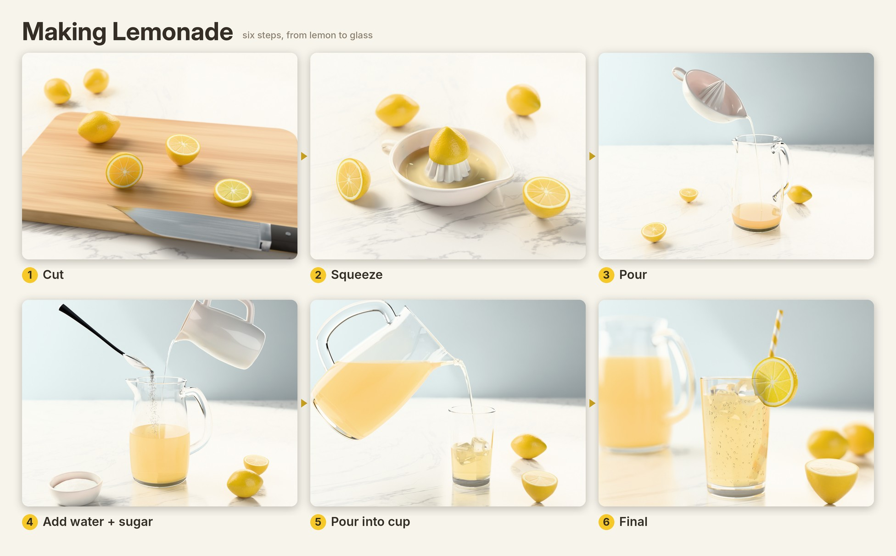

# Lemonade storyboard render

Photoreal Blender (Cycles) render of the hand-drawn lemonade sketch:
cut → squeeze → pour → add water + sugar → pour into cup → final.



- `renders/lemonade_storyboard.png` — all six steps in one picture
- `renders/step1.png` … `step6.png` — individual frames (1440×1080)

Re-render (CPU, ~1 h at the default quality):

```sh
python -m venv venv && venv/bin/pip install bpy==5.2.2 pillow scipy
PY=venv/bin/python ./render_all.sh            # SCALE / SAMPLES env vars change quality
```

`make_textures.py` builds the lemon cross-section textures, `lemonade.py --step N` builds and
renders one scene, `storyboard.py` lays the frames out.
