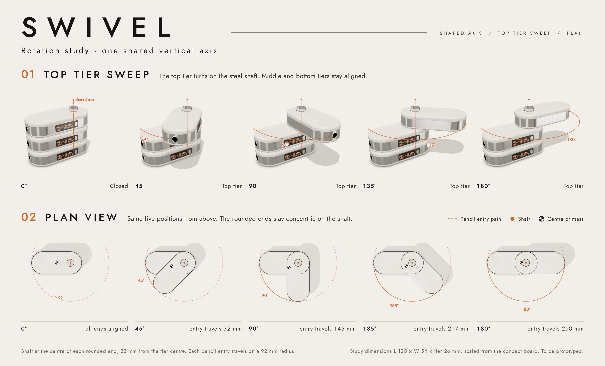
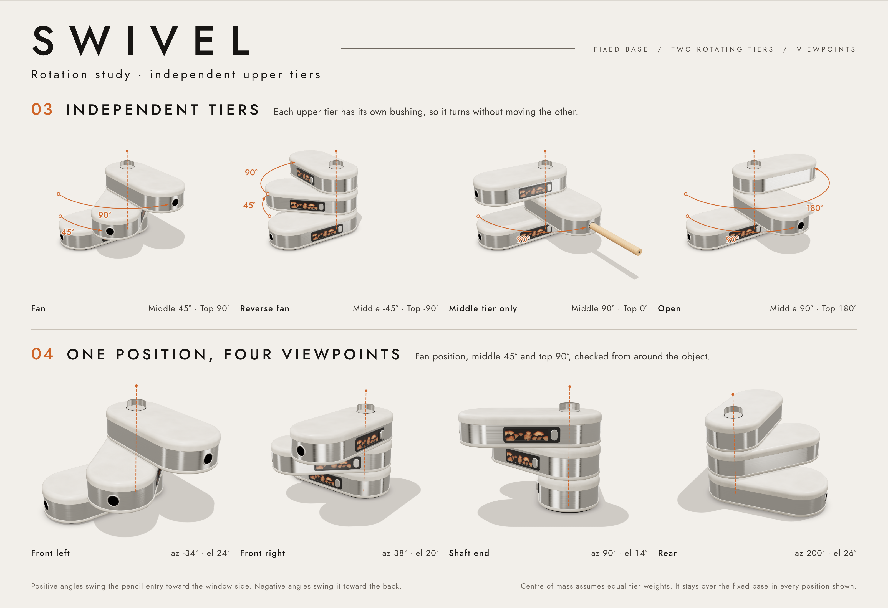
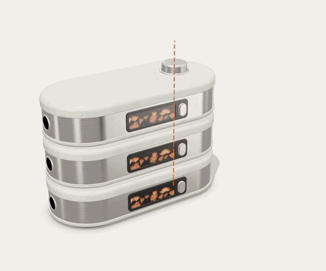

# SWIVEL rotation study

Correct rotation views of SWIVEL, the three-tier rotating pencil sharpener. Every view comes from one parametric 3D model, so all tiers turn on the same vertical shaft.





## The mechanism as modelled

- **One shaft.** A single steel shaft runs through the centre of every tier's right-hand rounded end, 33 mm from the tier centre. The bottom tier is fixed. The middle and top tiers each turn on their own bushing, with a thrust washer in the 1 mm gap between tiers.
- **Pencil entry on the free end.** The pencil hole is in the rounded end opposite the shaft, so turning a tier swings its entry out on a 92 mm radius.
- **Concentric ends.** The shaft sits at the centre of the rounded end, so the shaft ends of all three tiers stay on one circle at every angle. The plan views use this as a quick check that the tiers share an axis.
- **Angles.** Positive angles swing the pencil entry toward the window side, and negative angles swing it toward the back.
- **Centre of mass.** With equal tier weights, the combined centre of mass stays over the fixed base at every angle, including 180° on both upper tiers.

Study dimensions are scaled from the concept board: L 120 × W 54 mm, tier height 26 mm. Change them in `DIM` in `swivel-model.js` and re-render; every view, arc and readout follows.

## What corrects the concept board

Panel 02 "Rotated" on the original board shows tiers that slide sideways as well as rotate, so they don't share a pivot. It also shows the pencil going into the bottom tier at the end where the shaft would be. In these views each tier turns about the shaft only, and the pencil enters the free end.

## Files

| File | What it is |
| --- | --- |
| `swivel-model.js` | Parametric model: stadium-section tiers swept from a profile (ivory shell, nickel band, filleted lid), window with shavings, slider, pencil entry, cap, washers, pose helpers |
| `studio.js` | Studio lighting environment, shadow floor, camera framing |
| `rotation-sheet.html` | The two presentation boards (18 views) |
| `animation.html` | Looping swing animation, encoded as a GIF |
| `viewer.html` | Interactive viewer: tier sliders, preset positions, camera viewpoints, live plan check |
| `render.mjs` | Headless renderer that writes everything to `renders/` |
| `renders/` | Boards, 18 individual views (1200 × 1000 PNG) and the GIF |

## Rendering

```sh
cd swivel
npm install
npm run render
```

This needs Playwright with Chromium; it uses a global install if `playwright` isn't installed locally. Rendering runs on software WebGL, so no GPU is needed. three.js, gifenc and the Jost font are served from `node_modules`, so it also works offline.

To use the viewer, serve the folder (for example `npx serve .`) and open `viewer.html`. It loads three.js from the jsDelivr CDN.
